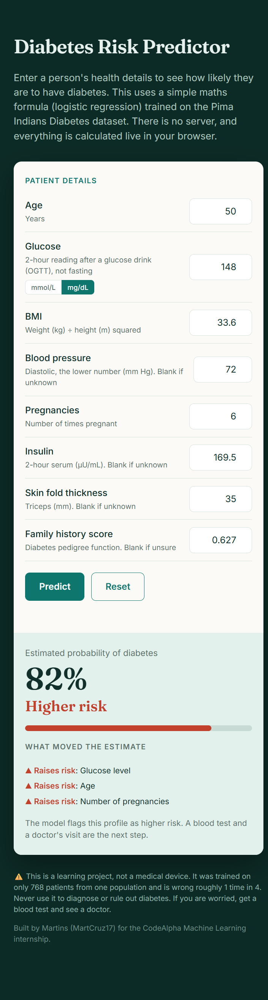

# Diabetes Risk Prediction

A machine learning project that predicts whether a patient is likely to have diabetes, built for my CodeAlpha Machine Learning internship. It comes with a small web page where anyone can type in a patient's details and get an estimate.

**Live demo:** https://martcruz17.github.io/CodeAlpha_DiseasePrediction/



## Dataset

The Pima Indians Diabetes dataset: 768 patients, 8 medical measurements (glucose, BMI, age, insulin and so on) and a yes/no diabetes outcome. About 35% of the patients are diabetic.

One thing worth knowing: the glucose column is the plasma glucose reading taken **2 hours after a glucose drink** (an oral glucose tolerance test), measured in mg/dL. It is not a fasting reading.

## What I did

1. Explored the data: class balance, distributions, correlations
2. Treated the impossible zeros as missing values
3. Split the data first (80/20, stratified), then filled the gaps with medians learned from the training set only, so nothing from the test set leaked in
4. Scaled the features (training-set statistics only) for Logistic Regression
5. Trained Logistic Regression and Random Forest, both with balanced class weights
6. Compared them with 5-fold cross-validation, using pipelines so the imputing and scaling happen inside each fold
7. Built a web demo from the Logistic Regression model

## Results

5-fold cross-validation:

| Metric | Logistic Regression | Random Forest |
|---|---|---|
| Accuracy | 0.747 | 0.763 |
| Recall | 0.727 | 0.765 |
| Precision | 0.623 | 0.636 |
| F1 | 0.669 | 0.693 |
| ROC-AUC | 0.836 | 0.837 |

Random Forest came out slightly ahead, mainly because it catches more diabetic patients (higher recall), which matters most in a screening task. The two models rank patients almost equally well, so the advantage is small.

On the held-out test set (154 patients, 54 of them diabetic):

| Model | Recall | Precision | Accuracy | ROC-AUC |
|---|---|---|---|---|
| Logistic Regression | 0.70 | 0.60 | 0.73 | 0.813 |
| Random Forest | 0.72 | 0.61 | 0.74 | 0.819 |

Glucose was the strongest predictor by a wide margin, followed by BMI, age and insulin.

## The web demo

The demo is a single `index.html` file hosted on GitHub Pages. There is no server and no data leaves your browser.

It uses the **Logistic Regression** model rather than the Random Forest. The reason is simple: logistic regression is just a formula. The page scales each input, multiplies it by the coefficient the model learned, adds everything up and turns the total into a probability, which only takes a few lines of JavaScript. The Random Forest ranks patients almost as well (ROC-AUC 0.837 vs 0.836), but it would mean shipping 200 decision trees to the browser.

A few details:
- **Required fields:** age, glucose and BMI. Anything left blank is filled with the typical (median) value from the training data, and the page tells you when that happens.
- **Glucose units:** you can enter mmol/L or mg/dL. The page converts to mg/dL because that is what the model was trained on. Enter the 2-hour reading, not a fasting one, or the result will underestimate the risk.
- **What moved the estimate:** the result panel lists the top factors that raised or lowered the risk for that patient. This is possible because each coefficient in logistic regression can be read directly.
- **Risk labels:** under 35% is lower risk, 35% to 50% is medium, and 50% or more is higher risk (where the model flags the patient).
- The percentages come from a model trained with balanced class weights, so they are best read as a relative risk score, not the true chance of having diabetes.

## Limitations

- The dataset is small, so scores shift depending on the split
- Precision is around 0.6, so roughly 4 in 10 flagged patients would be false alarms
- A large share of the Insulin and SkinThickness values were missing and had to be estimated
- The data comes from one population (women of Pima Indian heritage, aged 21 and above), so it may not generalise elsewhere
- This is a learning project, not a medical tool, and should never be used to diagnose or rule out diabetes

## Files

```
├── DiseasePrediction.ipynb   # full notebook: exploration, cleaning, models, evaluation
├── diabetes_rf_model.pkl     # saved Random Forest pipeline
├── index.html                # the web demo
├── requirements.txt
└── README.md
```

To use the saved Random Forest:

```python
import joblib
model = joblib.load("diabetes_rf_model.pkl")
model.predict(new_patient_dataframe)
```

To try the web demo, open the live link above, or open `index.html` directly in your browser.
